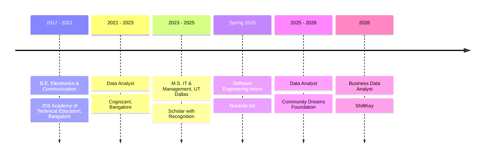
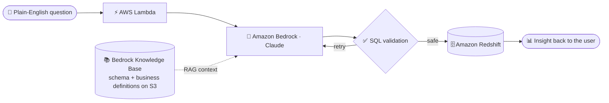

<!-- ═══════════════════════════  HEADER  ═══════════════════════════ -->


<div align="center">

<a href="https://git.io/typing-svg"></a>

<a href="https://www.linkedin.com/in/ananyasrinathachar/"></a>
<a href="mailto:ananya.s.achar1@gmail.com"></a>


</div>

<br>

### `> whoami`

```sql
SELECT  name, role, superpower, currently, off_the_clock
FROM    people
WHERE   github = 'ananyas1999'\G

-- *************************** 1. row ***************************
--          name: Ananya
--          role: Data Analyst, 4+ years
--    superpower: finding the pattern nobody asked for,
--                then automating the report after it
--     currently: letting LLMs write the SQL (and checking their work)
-- off_the_clock: sentiment-scoring Taylor Swift albums
-- 1 row in set. Recruiter interest: high.
```

---

### 📈 Impact board

<div align="center">

| ⏱️ Analysis time | 🎯 Forecast accuracy | 🔁 Manual work | ⚡ Query dev time | 🤖 Agent accuracy | 🏢 Systems unified |
|:---:|:---:|:---:|:---:|:---:|:---:|
| **−55%** | **+14%** | **−6 hrs/wk** | **−60%** | **90%** | **8** |
| automated prep & reporting | SQL capacity-pattern analysis | Excel automation | text-to-SQL agent | RAG over schema docs | ETL mapping at Cognizant |

</div>

---

### 🧭 The journey so far



<details>
<summary><b>💼 ShiftKey</b> — Business Data Analyst · Mar – Jul 2026 · Dallas</summary>
<br>

- Dug through high-volume operational data in SQL, surfaced recurring capacity patterns, and lifted demand-forecast accuracy **14%**
- Built one common language of volume, utilization and efficiency metrics so **8 business segments** could finally be compared fairly
- Turned a weekly manual metrics grind into an automated Excel report — **6 hours/week** handed back to the team
- Sharpened launch and promo targeting with performance analysis, nudging campaign effectiveness up **9%**

</details>

<details>
<summary><b>🌱 Community Dreams Foundation</b> — Data Analyst · Sep 2025 – Mar 2026</summary>
<br>

- Automated the data prep behind recurring reports and cut monthly analysis time by more than half (**−55%**)
- Pulled **12 initiatives** into a single set of KPI dashboards instead of a dozen scattered reports
- Segmented audiences by behavior and trend, raising campaign response rates **13%**

</details>

<details>
<summary><b>☁️ Nuvento Inc</b> — Software Engineering Intern · Feb – May 2025</summary>
<br>

- Wrote reusable SQL for extract → transform → validate, trimming processing time **20%**
- Helped run an AWS pipeline (S3 → Lambda → Redshift) moving **50K+ records**
- Built and tested forecasting models in SageMaker, improving accuracy **10%**

</details>

<details>
<summary><b>🏢 Cognizant</b> — Data Analyst · Sep 2021 – Jul 2023 · Bangalore</summary>
<br>

- Traced recurring transaction failures in Oracle with SQL, cutting operational exceptions **30%**
- Wrote the source-to-target mappings and ETL rules that kept data consistent across **8 enterprise systems**
- Replaced hand-built management reports with Excel + VBA automation (**−45%** reporting time)
- Used regression and clustering on transaction patterns to push forecast accuracy up **12%**
- Kept **18 management metrics** trustworthy with automated reconciliation checks

</details>

---

### 🤖 Flagship build — AI Database Assistant

> Ask a business question in plain English, get back validated SQL and the answer. No ticket, no wait.



**−60%** query-development time · **90%** accuracy on the test question set · `Bedrock` `Claude` `Lambda` `Redshift` `S3` `RAG`

<!-- TODO: push this project to a repo and link it here: https://github.com/ananyas1999/<repo-name> -->

---

### 🧪 More from the lab

| | Project | The interesting bit | Stack |
|:-:|---|---|---|
| ❄️ | **[Snowflake + dbt ELT](https://github.com/ananyas1999/snowflake-dbt-elt-pipeline)** | CDC-style pipeline: S3 landing → raw, staging, incremental and mart layers, with tests | Snowflake · dbt · S3 · Python |
| 🧠 | **[Unmasking OCD](https://github.com/ananyas1999/OCD--Tableau-and-SQL)** | Finds the "silent sufferers" a severity score alone would miss | MySQL · Tableau |
| 🩺 | **[Cirrhosis Outcomes](https://github.com/ananyas1999/cirrhosis_outcome_prediction)** | 7 tracked experiment versions chasing the lowest log loss | scikit-learn · MLflow · Databricks |
| 🚛 | **[Truck Fleet Safety](https://github.com/ananyas1999/Truck-Fleet-Analysis)** | Telematics signals that flag unsafe long-haul driving | Analytics · Storytelling |
| 🎤 | **[Taylor Swift × Data Science](https://github.com/ananyas1999/TAYLOR-SWIFT-and-DATA-SCIENCE)** | NLP sentiment & subjectivity across every era | Python · NLP |

---

### 🧰 Toolkit

<div align="center">


<br><br>


<br><br>

**Methods:** regression · clustering · forecasting · data mining · model validation · ETL design · KPI dashboards

</div>

### 🏅 Certified

<div align="center">


🎓 **M.S. IT & Management, UT Dallas** — 3.63 GPA · Scholar with Recognition

</div>

---

### 🐍 Eating my contribution graph

<div align="center">
<picture>
  <source media="(prefers-color-scheme: dark)" srcset="https://raw.githubusercontent.com/ananyas1999/ananyas1999/output/github-snake-dark.svg" />
  <source media="(prefers-color-scheme: light)" srcset="https://raw.githubusercontent.com/ananyas1999/ananyas1999/output/github-snake.svg" />
  
</picture>
</div>

---

<div align="center">

**If you have messy data and a question nobody can answer yet — let's talk.** 

</div>


